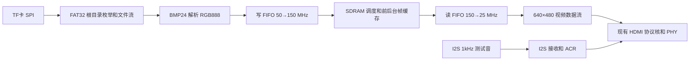

# HDMI 图片轮播项目 RTL 设计说明

本文说明现有基础功能RTL：TF卡SPI读取、FAT32根目录BMP枚举、640×480 RGB888图片解析、SDRAM帧缓存、上一张和下一张切换、自动轮播、I2S测试音及HDMI音视频输出。系统RTL顶层为`fpga_hdmi_top`，但当前TD工程登记未与系统RTL同步，见本文末节。

当前状态及下一阶段扩展1至4请先读 [项目交接文档](项目交接文档.md)。四个新增RAM/ROM和字模、Logo已准备并做静态核对，扩展RTL尚未编写；本文不将这些规划写成已经实现的基础功能。

本次范围为代码编写和静态检查。没有运行行为仿真、时序仿真、综合、布局布线或烧录。基础功能的实际运行结果尚未通过这些流程验证。

## 时钟和复位

| 时钟 | 实际频率 | 用途 |
|---|---:|---|
| 板载输入 `clk_50m` | 50 MHz | SPI、FAT32、BMP、按键、轮播控制 |
| `pll_sdram.clk0_out` | 150 MHz、0° | SDRAM 控制器及帧缓存调度 |
| `pll_sdram.clk1_out` | 150 MHz、180° | SDRAM 移相时钟 |
| `pll_hdmi.clk0_out` | 125 MHz、0° | HDMI PHY 串行发送 |
| `pll_hdmi.clk1_out` | 25 MHz、0° | 视频输入、内部 I2S、音频接收、ACR |

HDMI 全部逻辑按实际生成的 25 MHz / 125 MHz 适配。总时序保持 800×525，有效区 640×480，实际刷新率约为 59.52381 Hz。HDMI 封装的 `IIC_SCL_DIV=126` 对应约 99.206 kHz DDC 时钟。

配置时初始化为零的 16 位计数器产生上电复位，持续 65535 个 50 MHz 周期。按键4直接请求全局复位。两个 PLL 均锁定后，50 MHz、150 MHz、25 MHz 时钟域分别通过 `reset_sync` 同步释放复位。

## 顶层接口

| 接口 | 说明 |
|---|---|
| `clk_50m` | 板载 50 MHz 输入 |
| `key_n[0]` | 按键1，上一张，低有效 |
| `key_n[1]` | 按键2，下一张，低有效 |
| `key_n[2]` | 按键3，切换自动轮播，低有效 |
| `key_n[3]` | 按键4，全局复位，低有效 |
| `sd_cs_n / sd_sck / sd_mosi / sd_miso` | TF 卡 SPI Mode 0 |
| `tmds_ch0_p / tmds_ch1_p / tmds_ch2_p / tmds_clk_p` | 沿用现有 HDMI PHY 的输出端口约定 |
| `ddc_scl / ddc_sda` | 现有 HDMI 核的 DDC 端口 |
| `status_led[3:0]` | 基础运行状态指示 |

按键1至3使用两级同步及20 ms消抖；按住一次只产生一次事件。按键4采用异步复位请求，释放由各时钟域同步处理。RTL 中按键低有效；实际引脚和电平需由板级原理图对应。

顶层参数 `AUTO_DEFAULT=1`，默认开启自动轮播；`AUTO_INTERVAL_MS=5000`，每张图片提交显示后停留约5秒再加载下一张。按键切图在加载期间保留最近一次方向请求，当前加载完成后处理。到达首尾图片时循环切换。

状态灯默认高有效，参数 `STATUS_LED_ACTIVE_LOW=1` 可整体反相：

| 状态位 | 点亮条件 |
|---|---|
| 0 | SD 初始化完成、SDRAM 初始化完成且 HDMI 视频核锁定 |
| 1 | 初始化、加载、等待提交、重试或故障停机 |
| 2 | 自动轮播开启 |
| 3 | 文件、存储、FIFO 或视频通路异常 |

## 素材和文件系统

- TF 卡采用 FAT32，512 字节逻辑扇区；支持 SDHC/SDXC 的块寻址 SPI 模式。
- 支持裸 FAT32 卷，或 MBR 内 0B/0C 类型主分区；文件和根目录簇链均按 FAT 逐簇访问，支持碎片文件。
- 将 BMP 放在根目录。上电扫描普通文件短目录项，以 `.BMP` 扩展名建立索引；顺序采用目录中的存储顺序，不按文件名字母排序。
- 不要求固定文件名或人工设置图片数量。索引计数为16位，最多计入65535个候选文件。
- 每张图片要求 640×480、24 bit、`BI_RGB` 非压缩，文件内颜色字节顺序 B、G、R。
- 支持高度 `+480` 的自底向上 BMP，以及高度 `-480` 的自顶向下 BMP。
- 检查 BM 标志、DIB 头长度、宽高、平面数、位深、压缩字段、像素偏移及文件长度。640像素一行占1920字节，已经满足BMP的4字节行对齐。
- 未实现 exFAT、FAT12/16、GPT、子目录浏览、压缩解码、缩放、字幕或转场。

文件解析失败时，继续尝试同方向的其他候选 BMP。当前显示区保留上一张有效图片，只有完整成功的新帧才允许提交。没有任何可用图片时输出黑色画面并定期重新尝试；存储或 SDRAM 致命故障通过按键4复位。

读取栈来自 `docs/reference_rtl/fat32` 的项目副本，原参考文件保留。项目副本修正了 `sd_spi_cmd` 中不完整的计数增量，以及 `sd_spi_card` 中 CMD58 条件缺失的右括号；FAT32 层增加了根目录候选图片计数和按索引打开接口。顶层固定 `req_write=0`，只读取TF卡。

## 数据通路和帧缓存



使用同一个 `fifo_pixel_async` IP 定义，例化为两个独立 FIFO。均为32位、配置深度1024；按当前IP模式实际容量为1023个字。每个字 `[23:0]` 为RGB888，`[31:24]` 为零。读端使用普通模式的 `re`、`valid` 响应，未按Show Ahead模式读取。

异步FIFO的复位由读写两侧共同完成，操作前检查相应的 `wr_rst_done` 和 `rd_rst_done`。计数端口 `wrusedw`、`rdusedw` 均按实际生成文件使用10位。

| 帧区域 | SDRAM 起始字地址 | 容量 |
|---|---:|---:|
| 区域0 | 0 | 307200个32位字 |
| 区域1 | 307200（0x4B000） | 307200个32位字 |

每个像素占一个32位字，双帧共占2457600字节，小于片内8 MiB SDRAM容量。先完整写入后台区域，文件解析和写入均成功后，再在视频垂直消隐期间切换前台区域。此双帧机制用于保证基础切图的完整性，不实现扩展转场。

底向上BMP通过反向选择SDRAM行地址恢复图像方向；每行内部地址仍递增，不改变像素的左右顺序。

## SDRAM 调度和刷新

沿用现有 `sdram_ram_wrapper`、厂商控制器及 `EG_PHY_SDRAM_2M_32`。

- 调度器把读写操作拆为64字连续事务，首地址和长度均满足4字对齐。
- 读写方向互斥，方向切换前等待当前事务返回及流水线排空。
- 视频读取优先补充读FIFO；写FIFO累计至少64字后执行一次写事务。
- 读事务发出前预留完整64字空间，并按 `Sdr_rd_en` 接收数据，不假定请求当拍即返回数据。
- 依照 APUG011 中对 `Sdr_busy` 保留状态的说明，仲裁由自身状态机和 `Sdr_init_ref_vld` 完成，不依赖保留忙信号。
- 关闭控制器内部定时刷新（`SELF_REFRESH_OPEN=0`），由调度器在空闲事务边界经 `App_ref_req` 请求刷新，等待刷新标志先有效再结束。
- 每4000个150 MHz周期安排一次刷新，约26.667微秒；正常事务排空和FIFO复位等待都留有余量，避免刷新与用户事务冲突。

每次垂直消隐发送一次帧请求。SDRAM侧排空旧读事务后，同时复位视频FIFO的读写侧，保持96个SDRAM周期，再等待两侧复位完成，开始下一帧预取。像素域保持固定800×525节拍，在下一有效帧开始前检查一行数据的预取量。有效行中不因 `ready` 或FIFO空而暂停视频节拍；异常通过状态位记录，并在下一帧消隐重新对齐。

跨域多位命令通过 `cdc_mailbox` 传递，源端保持数据直至目的端确认；独立状态位使用 `cdc_level`。图像开始、完成/取消、提交结果、视频帧请求和帧状态各有独立握手通道。

## 音频和 ACR

内部测试音为双声道同相约1 kHz方波，24位有效样本、每声道32位时隙，标准64fs I2S时序。所有音频寄存器由25 MHz像素时钟驱动，BCLK是内部数据信号，不用作寄存器时钟。

分数累加器产生平均6.144 MHz的BCLK半周期使能，得到平均3.072 MHz BCLK及48 kHz立体声采样率。相邻样本对间隔为520或521个像素周期，避免25 MHz直接整数分频的采样率误差。

I2S接收器在LRCK切换后跳过一个延迟位，再接收左右声道的24位数据。接收得到的并行样本送入现有HDMI核；首次有效图片开始显示、视频核锁定后开启音频提交。

ACR使用实际25 MHz像素/TMDS时钟，`N=6144`、`CTS=25000`：

```text
Fs = 25,000,000 × 6144 / (128 × 25000) = 48,000 Hz
```

每48对样本提交一次ACR更新。生成的PLL和FIFO文件保持原样，没有另生成音频PLL或音频FIFO。

## 工程文件和静态检查

截至交接时，`project1.al`实际顶层仍是`hdmi_tx_640x480`，Verilog部分仅登记9个HDMI/SDRAM文件，缺少18个基础系统RTL。旧PLL/FIFO和四个新增RAM/ROM已有IP入口；后续集成需补齐源码并将系统顶层设为`fpga_hdmi_top`。早期“工程已完整登记”的描述不符合当前文件状态，已在此修正。

`rtl/sources.f`提供基础版纯源文件清单及SDRAM头文件搜索目录，共30个源路径，当前尚未加入四个新RAM/ROM及后续扩展RTL。TD工程通过`.ipc` / `.xml`入口引用生成IP，保留其附带文件，避免再把同名生成Verilog/VHDL重复登记。

SDRAM头文件目录为 `rtl/sdram`。后续在其他工程中引入时，应同时添加该Include目录，以及 `sources.f` 所列的RTL和实际IP文件。`docs/reference_rtl` 为参考资料目录，不应再重复加入编译，以免产生同名模块。

静态检查采用Verilog-2005语法规则，检查了项目公开RTL的语法、模块解析、参数和端口连接。厂商加密部分仅以公开端口/参数声明参加接口检查，没有解密或替换项目中的厂商实现。

基础代码编写阶段的历史静态检查结果为0个错误。剩余提示属于有意悬空的未用输出、厂商PHY未命名generate块、原PHY末尾换行，以及TD生成PLL的空载隐式网络。这不是当前TD工程完整登记已通过检查，也不适用于尚未编写的扩展RTL；不包含厂商加密内部功能、动态协议行为、时序收敛、板级电气和显示器兼容性验证。

当前未提供开发板引脚表或原理图，本次未生成引脚约束或修改板级电气设置。HDMI物理层继续使用原封装的端口约定，物理差分配对、电平和引脚应依照开发板原理图及原参考方案配置。
