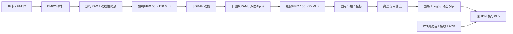

# HDMI 图片轮播项目 RTL 设计说明

更新：2026-10-24。基础功能与扩展1、2、3、4已完成RTL集成，系统顶层为 `fpga_hdmi_top`。本轮只做源码、工程登记和静态核对，没有运行仿真、综合、布局布线或烧录，不能据此认定硬件功能或时序已经通过。

## 时钟、复位与接口

| 时钟 | 实际频率 | 用途 |
|---|---:|---|
| 板载 `clk_50m` | 50 MHz | SPI、FAT32、BMP、加载缩放、按键、轮播、拨码与运行时间 |
| `pll_sdram.clk0_out` | 150 MHz、0° | SDRAM、块缓存、双图混合 |
| `pll_sdram.clk1_out` | 150 MHz、180° | SDRAM接口移相时钟 |
| `pll_hdmi.clk0_out` | 125 MHz | HDMI串行PHY |
| `pll_hdmi.clk1_out` | 25 MHz | 像素、调色、OSD、I2S与ACR |

HDMI有效区640×480，总时序800×525，刷新率约59.52381 Hz。DDC保持 `IIC_SCL_DIV=126`，约99.206 kHz。PLL生成文件没有修改。

16位上电计数器初始化为0，在65535个50 MHz周期后释放上电复位；按键4也请求全局复位。等待两个PLL锁定后，各域通过 `reset_sync` 同步释放。运行时间从系统复位释放开始计数，按键4会清零。

| 顶层接口 | 用途 |
|---|---|
| `key_n[0]` | 按键1，上一张，低有效 |
| `key_n[1]` | 按键2，下一张，低有效 |
| `key_n[2]` | 按键3，自动轮播开关，低有效 |
| `key_n[3]` | 按键4，全局复位，低有效 |
| `switch[1:0]` | 开关2、1组成的亮度编码，开关1为低位 |
| `switch[3:2]` | 开关4、3组成的对比度编码，开关3为低位 |
| `sd_cs_n / sd_sck / sd_mosi / sd_miso` | TF卡SPI Mode 0 |
| `tmds_ch0_p / tmds_ch1_p / tmds_ch2_p / tmds_clk_p` | 沿用厂商PHY输出约定 |
| `ddc_scl / ddc_sda` | HDMI DDC |
| `status_led[3:0]` | 就绪、忙、自动轮播、错误 |

按键1–3两级同步、20 ms消抖，按住只产生一次事件。拨码整体经过两级同步和20 ms稳定检测。`SWITCH_INVERT_MASK[3:0]` 默认全0，逻辑编码为 `switch ^ SWITCH_INVERT_MASK`，可根据板卡ON电平调整。两组编码均为01时保持原图参数。未提供板级引脚和电平资料，本轮没有编造引脚约束。

状态灯默认高有效，`STATUS_LED_ACTIVE_LOW=1` 时反相。位0为SD初始化、SDRAM初始化及HDMI锁定均完成；位1覆盖初始化/加载/等待转场/重试/故障；位2为自动轮播；位3为存储、解码、FIFO或视频异常。

## 基础存储、轮播与音频

SPI初始化250 kHz、数据阶段5 MHz。支持SDHC/SDXC块寻址；文件系统为512字节扇区FAT32，支持裸卷或MBR中0B/0C分区，以及根目录和文件的FAT簇链碎片。按根目录存储顺序枚举普通 `.BMP` 短目录项，最多65535个候选，不按文件名排序。

`AUTO_DEFAULT=1` 默认开启轮播，`AUTO_INTERVAL_MS=5000` 默认停留5秒。第一张有效图片直接提交，后续图片在转场结束后提交，从这时开始停留计时。加载或转场期间保留最近一次手动方向，首尾循环。失败候选按原方向跳过，当前有效帧不被半成品替换；没有有效图片时保持黑色底图和OSD并定期重试，存储/SDRAM致命故障仍需按键4复位。

存储层和音频层保持准备提交中的实现，没有用 `docs/reference_rtl` 覆盖适配后的源码；参考目录不参与编译。未增加exFAT、子目录、压缩图片、WAV、FFT/DFT或扩展5。

内部测试音仍为约1 kHz双声道同相方波，24位有效样本、32位声道时隙、64fs I2S。所有音频寄存器用25 MHz时钟，BCLK仅为数据信号。分数累加器产生平均3.072 MHz BCLK和48 kHz采样率；接收端在LRCK翻转后跳过一位再接收24位数据。有效图片显示且HDMI锁定后允许音频提交。

ACR保持 `N=6144`、`CTS=25000`，每48对样本更新一次：

```text
Fs = 25,000,000 × 6144 / (128 × 25000) = 48,000 Hz
```

## 完整数据通路



原 `fifo_pixel_async` 定义继续实例化两次：32位×1024，普通模式可用容量1023字，`SHOW_AHEAD_EN=0`，`OUTREG_EN="NOREG"`。读取使用 `re` 和返回 `valid`，计数宽度10位，两侧复位完成后才操作。

## 扩展3：BMP解析与加载时双线性缩放

`bmp24_decoder` 接收24位、BI_RGB、宽高各1–4096的BMP，支持正高度底向上和负高度顶向下。检查BM标志、DIB长度、尺寸、平面数、位深、压缩、像素偏移、声明文件长度、位图长度及目录文件长度。行跨度为 `(3*width+3)&~3`，每行消费0–3个填充字节。尺寸13位、RAM地址12位，长度相加保留33位进位，超限或截断被拒绝。

`bilinear_scaler` 实例化两个实际 `ram_scale_line`，A写B读，两口均50 MHz。两个RAM按源行奇偶保存相邻行。输出目标行期间暂停源像素接收，解析器通过单像素暂存和 `file_ready` 向文件层反压；下采样仍消费中间源行，但不为无关行生成目标输出。上采样复用已有行，不缓存整幅原图。

端点对齐坐标为 `sx=x*(width-1)/639`、`sy=y*(height-1)/479`。商/余数累加精确生成整数地址；余数乘256后除常数639/479得到Q8小数权重。第二邻点在末边夹取，宽/高为1时使用同一邻点。同步RAM先取左邻点，再取右邻点；一个有符号乘法器分时计算三个通道的水平和垂直插值。水平值保留Q8精度，纵向乘加后加32768并右移16位四舍五入。

始终输出640×480，即307200个 `0x00RRGGBB` 像素。`pixel_valid` 在背压下保持数据；`image_complete` 只在最后目标像素握手后成立，`done` 还要求已接收文件尾。EOF不会提前结束缩放。取消/错误停止缩放，帧缓存丢弃加载FIFO尾部。

输出行顺序保持BMP文件顺序，底向上仅由SDRAM反向选择目标行地址，避免双重翻转。4096是实现上限，不是无限尺寸支持。

## 扩展2：双帧淡入淡出与SDRAM调度

| 区域 | 起始字地址 | 容量 |
|---|---:|---:|
| 区域0 | 0 | 307200个32位字 |
| 区域1 | 307200（0x4B000） | 307200个32位字 |

双目标帧共2457600字节。加载只写后台，完整写入且解析通过后才成为待显示帧。第一幅直接在帧边界提交；已有前台时，在垂直消隐开始转场。

`sdram_frame_store` 使用9位Alpha，首帧0，每帧加4直至256，全帧保持权重：

```text
out = ((256-alpha)*old + alpha*new + 128) >> 8
```

从0到256共64个帧间隔，约1.0752秒；256保持完整显示帧后，在下一消隐返回成功 `result`，总占用65个帧间隔约1.092秒。应答之前 `pending_front/transition_active` 锁住两区域，不能预加载第三张。轮播控制器等待应答，之后才更新编号、开始停留或处理待执行按键。

每次读旧图64字到 `ram_fade_block` 的一个半区，再读新图同地址块；两个64字半区交替使用。第二次读取按返回计数寻址旧像素，将同步RAM数据与延迟一拍的新像素配对，注册混合结果后写视频FIFO。读返回依赖 `Sdr_rd_en`，其间可存在空拍。事务和混合流水排空后才进入下一事务或刷新。

保留厂商接口规则：读写互斥、每次64字、首地址/长度四字对齐、切方向前排空，不用保留的 `Sdr_busy` 作仲裁。视频读取要求FIFO已用量≤896，为完整64字和流水预留空间。无图像时输出黑色底图，调色不抬高无效图像黑电平。

`SELF_REFRESH_OPEN=0`，每4000个150 MHz周期优先安排手动刷新，经 `App_ref_req` 请求，等待 `Sdr_init_ref_vld` 有效并结束。两次配对读之间可刷新并保留旧块。事务及FIFO复位有有限等待和故障标志。

每次垂直消隐发帧请求，SDRAM先排空在途返回和混合流水，再复位视频FIFO两端，保持96个SDRAM周期，等待两端完成后重新预取。帧同步不清除整个转场任务。下一有效帧开始前要求至少640像素预取；有效行固定节拍，异常在下一消隐重新对齐。

## 扩展4：亮度、对比度及参数显示

| 两位编码 | 亮度B | 对比度C |
|---|---:|---:|
| 00 | -32 | 0.5 |
| 01 | 0 | 1.0 |
| 10 | +32 | 1.5 |
| 11 | +64 | 2.0 |

`video_color_adjust` 用有符号移位/加法组合译码：

```text
B = 32 * (brightness_code - 1)
C = (contrast_code + 1) / 2
out = clamp(round((in - 128) * C) + 128 + B, 0, 255)
```

半值按远离零方向舍入，先扩位再运算、饱和，不发生00减1的无符号下溢。调色先于OSD，一拍寄存、每拍一个像素；OSD显示实际B和C。

## 扩展1：分层Alpha、运行时间与滚动标语

`display_control` 在50 MHz域计数BCD运行时间 `HH:MM:SS`，99:59:59后回绕。图片编号和总数用16轮串行double-dabble转为5位BCD。拨码、时间、自动轮播/忙/转场/错误状态、编号组成72位快照，经 `cdc_mailbox` 原子传输，像素域每帧垂直消隐锁存。

`video_osd` 直接使用准备好的字模和Logo：

| 区域 | 布局与规则 |
|---|---|
| 运行时间 | 左上 `(16,16)`，“运行 HH:MM:SS” |
| Logo | `(496,8)`，128×64，保持比例与透明留白 |
| 参数 | `(16,384)`，亮度、对比度 |
| 状态 | `(16,404)`，轮播开/关，错误优先于转场、加载、显示 |
| 图片编号 | `(16,424)`，当前/总数，首张提交前当前为00000 |
| 标语 | y=460，`安路 FPGA 多媒体展示`，每帧左移1像素，800像素周期 |

文字区域不重叠，共用单端口字库ROM，Logo使用独立ROM。中文使用 `font_cn_map.csv` 固定槽位；ASCII地址 `code*16+row`，中文地址 `2048+slot*32+row*2+half`，字节最高位对应最左像素。

合成顺序为半透明深色面板（128/256）、Logo、文字（240/256）。Logo的ARGB4444颜色扩为8位，Alpha=15映射256，其他值乘17；Alpha=0及字模0位保留下层。Logo地址 `y*128+x`。

OSD固定三级：同步ROM读取同时生成面板 → Logo混合 → 文字混合。RGB、x/y、valid/user/last同步流水，加上调色相对原视频流增加4拍固定延迟，不暂停有效行。HDMI ready异常在最终OSD输出端检查。动态参数、文字和位置在一帧内不变。

## 工程与验证范围

`project1.al` 顶层LABEL/MODULE均为 `fpga_hdmi_top`，Verilog登记31项（含SDRAM头文件）、IP登记7项。新IP通过 `.ipc` 引入，不重复登记 `.v/.vhd`。`rtl/sources.f` 共38个源路径，包含新增4个RTL和4个IP Verilog，保留 `+incdir+rtl/sdram`。

已清除旧顶层遗留的设计源/IP自动排除标记，保留 `global_def.v` 的头文件排除标记；所有设计源仍启用 `UsedInSyn`。

`tools/static_rtl_audit.py` 检查文件存在性、登记覆盖、IP入口/初始化路径以及Verilog-2005语法、名称、参数、端口和位宽。加密部分仅在内存中以公开声明参与检查，不解密、不保存替代实现、不产生网表。结果见 [静态核对记录](静态核对记录.md)。

未获得实际LUT/DSP/ERAM剩余量、SDRAM吞吐、时序收敛或板级兼容性结果；这些需要后续另行授权的验证流程。
