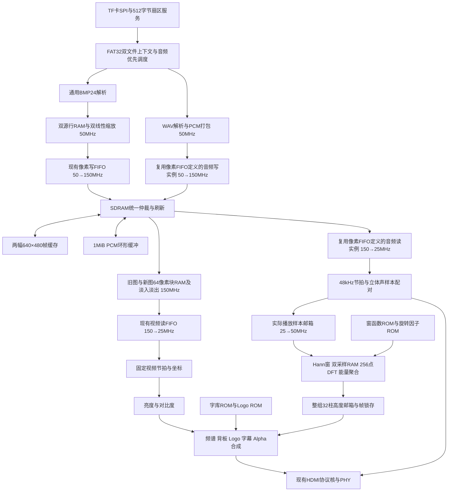

# 五项扩展架构规划

本方案记录基础图片轮播上集成扩展1至5的架构。七项IP已由用户生成，扩展RTL现已接入顶层；实现细节、厂商模型证据边界及待验证项见 [五项扩展RTL集成说明](五项扩展RTL集成说明.md)。现已开展 [ModelSim仿真验证](扩展1至5_ModelSim仿真报告.md)，综合和工程登记仍按用户要求暂缓。

用户已确定：音乐来自TF卡WAV文件；时间戳显示上电运行时间 `HH:MM:SS`。四个按键继续用于上一张、下一张、轮播开关和复位；拨码1、2用于亮度，3、4用于对比度，各四档；不读取EDID；SDRAM使用180°移相时钟。

按本文方案，**新增7个IP定义：4个ROM、3个RAM。无需新PLL或新FIFO定义。** 其中三个RAM各实例化两次，现有 `fifo_pixel_async` 从两个实例增加到四个实例。一个定义生成一次，同一模块可以多次例化，不能把两个缓存误接到同一个物理实例。

人工生成步骤见 [IP逐项配置清单](五项扩展IP逐项配置清单.md)。

## 设计范围与默认值

| 项目 | 本版规划 |
|---|---|
| HDMI输出 | 保持640×480 RGB888，总时序800×525，实际25 MHz像素时钟，约59.524 Hz |
| 扩展1 | 多图层Alpha合成、上电时间、水平滚动标语、安路Logo |
| 扩展2 | 双图交叉淡入淡出；先实现这一种转场，不同时增加左右滑动 |
| 扩展3 | 24位非压缩BMP，读取源宽高，双线性插值到640×480 |
| 输入尺寸边界 | 建议首版支持宽、高各1..2048的整数尺寸，含1920×1080；并非只支持几个预置分辨率 |
| 长宽比 | 默认铺满640×480；非4:3图会拉伸。等比黑边属于后续可调策略 |
| 扩展4 | RGB对比度与亮度处理，OSD显示档位对应的实际系数及状态 |
| 扩展5 | 48 kHz、24位立体声PCM WAV播放；对实际播放的左声道做256点DFT，合并为32根频谱柱 |
| 音乐文件 | FAT32根目录 `BGM.WAV`，循环播放；图片仍按BMP目录索引切换 |
| 回退音源 | 无有效WAV时保留原测试音，OSD以ASCII `TONE` 标明；播放WAV时标明 `WAV` |
| 自动轮播间隔 | 保留5秒停留，改为从转场结束开始计时；下一图未准备好时保留当前图 |

2048是本次缓存规模对应的实施边界，不是对赛题“任意分辨率”的无上限承诺。输入上限及长宽比是可调整的规划默认值；若需要4K宽图，须先增加行RAM深度并重新核算资源。超限或格式错误的BMP跳过，不能截断、回绕地址或覆盖前台帧。

WAV首版支持RIFF/WAVE、格式码1、双声道、24位小端有符号整数、48 kHz、块对齐6字节；校验ByteRate=288000。按chunk长度跳过JUNK/LIST等非音频块及奇数字节填充，不能假设data总在44字节处。压缩WAV、IEEE float、WAVE_FORMAT_EXTENSIBLE及其他采样率先明确拒绝；如以后扩充，不需要因此新增PLL。

## 系统框架

保留50 MHz系统域、150 MHz存储域、25 MHz像素域及125 MHz串行时钟。原PLL实际生成频率是设计依据；`pll_hdmi.ipc`记录的请求频率126/25.2 MHz不能替代生成Verilog中的125/25 MHz。

## 扩展1和4：统一视频流水线

视频流模块输出RGB及 `x/y/valid/user/last`；所有处理级都等长延迟这些控制字段。保持有效行内640个像素连续输出，不能因ROM读延迟、Alpha运算或HDMI ready而暂停有效行。流水线延迟只引入固定相位偏移，不改变行周期800拍及帧周期525行。

推荐图层顺序：背景图片/转场结果 → 亮度对比度 → 半透明频谱 → 信息背板 → Logo → 文字。参数调整只作用于照片，使字和频谱保持可读。Logo使用自身4位Alpha；文字使用1位字模加可配置全局Alpha，背板也参与Alpha合成，满足多图层混合。

时间从50 MHz的毫秒节拍累计，每秒更新，按99:59:59后回到00:00:00定义。滚动标语沿用“安路 FPGA 多媒体展示”，位置按视频帧更新，建议每2帧左移1像素；完整移出后从右侧重新进入。所有显示状态在帧边界形成快照，避免半帧数字变化。

字库为单端口ROM。一个像素至多查询一个最终文字字符：时间、参数、底部标语区域不互相重叠；如区域意外重叠，按固定优先级选择。Logo有独立ROM，因此可与文字逐像素混合。矩形、进度条、频谱柱、播放三角形与暂停双竖条均由坐标比较生成，无需增加图片ROM。

建议坐标：时间(8,8)，Logo画布(504,8)、128×64，参数区(8,368)，频谱区(320,320)、312×120，滚动标语条y=452..475。此为新排版规划；assets中的preview是素材示例，不是五项集成效果。

RGB每分量计算：`out = clamp(round((in - 128) * contrast) + 128 + brightness, 0, 255)`。拨码两级同步，稳定采样后在帧边界锁存；系数由两位档位组合译码。

| 编码 | 亮度：{开关2,开关1} | 对比度：{开关4,开关3} |
|---|---:|---:|
| 00 | 0 | 1.00× |
| 01 | +32 | 1.25× |
| 10 | -32 | 0.75× |
| 11 | +64 | 1.50× |

编码以RTL逻辑电平为准，实体ON/OFF与高低电平的对应留给板级极性参数。两组全0为默认正常图像；系数可用移位、加减实现，无需乘法器IP。OSD显示实际数值，不只显示0/1/2/3档号。

## 扩展2：双图淡入淡出

保留两个SDRAM帧区。新图完整写入且校验成功后，进入 `READY → TRANSITION → SHOW`。转场期间两区均只读，禁止后台开始第三张图。按键事件保存最近一次方向，转场结束释放旧帧后再处理；复位仍可随时打断。

在150 MHz域，每次分别读旧图64字、新图64字，存入两个独立 `ram_blend_block`。随后同时读两RAM，按对应像素混合并写入原视频FIFO。块RAM写入阶段与混合读取阶段分离，故单端口足够。无转场时直接走单帧读取路径。

转场系数采用9位 `a=0..256`，每分量 `((256-a)*old + a*new + 128) >> 8`。每次视频帧请求时锁存a及两幅图的区域选择，全帧不变。默认约60个帧间隔完成0→256；必须显式包含两个端点，a=256时输出精确等于新图。转场完成通知控制器后才能复用旧区。

SDRAM依然以64字、4字对齐的互斥事务操作；一次读完且响应排空后再切换地址或读写方向。刷新仍在事务边界执行，并保留初始化/刷新有效信号检查，不依赖保留的 `Sdr_busy`。

按每64像素两次读各约94拍、混合约72拍预算，约260个150 MHz周期得到64像素，约36.9 Mpixel/s，高于有效区25 Mpixel/s消费速度。这个估计含常规读排空和混合流水延迟，但不是性能验证；还需加入刷新、音频和写入仲裁做最坏情况仿真。视频FIFO预取阈值、缺数恢复及垂直消隐清空机制继续保留。

## 扩展3：加载阶段缩放

在50 MHz域使用两个独立 `ram_scale_line1`，每个24×2048。完整保留RGB888，不能照截图的16位示例生成。源图双行只需12 KiB物理数据容量，SDRAM始终保存统一的640×480目标图，不额外缓存整幅高分辨率源图。

映射采用端点对齐：`sx=x*(W-1)/639`、`sy=y*(H-1)/479`。取整数坐标及12位小数权重，边缘索引夹在W-1/H-1；W或H为1时相邻点相同，不发生除零。通过起始商/余数和步进器产生坐标，避免每像素使用组合除法器。

从两行取得四个相邻RGB像素，先横向后纵向做双线性运算。横向保留小数位，纵向后统一舍入并饱和到8位；不能以最近邻代替双线性。单端口RAM每行的两个x地址分拍读，两行并行读；缩放器允许反压输入，因此不用为这一阶段增加双端口RAM或FIFO定义。

处理自顶向下和自底向上BMP、任意宽度对应的4字节行填充、像素数据偏移、扩展DIB头及文件截断。采用端点对齐映射时，可按文件行顺序生成目标行，再用现有bottom_up写入方向恢复显示方向。重复使用源行时保持缓存；下采样跳过的源行仍正确消费其数据和padding。复用同一行时按逻辑行号标记，不误当作下一行。

文件偏移、`stride=((3*W+3)&~3)`、总长度及坐标乘法使用足够宽的中间值，再做边界检查。输入图格式失败时取消后台写入，保持前台图完整。

## WAV读取与SDRAM音频缓冲

现有FAT32模块只有一个打开文件上下文，不能直接让BMP与WAV轮流调用open并期待自动续读。需改为共享卷参数、独立图片/音频文件状态：首簇、当前簇、簇内扇区、文件位置、剩余长度和FAT查找状态分别保存。

底层一个SD SPI引擎以单扇区为调度单位。图片、音频各有一个512字节扇区缓存，避免图片解析反压时，其未消费扇区被音频覆盖；FAT查找也必须带请求归属。缓存可复用现有 `sd_sector_buffer` 的存储编码方式并改造请求接口，不要求用户再生成单独RAM IP。音频预取优先级由环形缓冲水位决定，不能等整张图片读取完成才切换音乐。

| 区域 | 32位字地址范围 | 容量 |
|---|---|---:|
| 图片区0 | 0x000000..0x04AFFF | 307200字 / 1228800字节 |
| 图片区1 | 0x04B000..0x095FFF | 307200字 / 1228800字节 |
| 预留 | 0x096000..0x0FFFFF | 后续用途 |
| 音频环形缓冲 | 0x100000..0x13FFFF | 262144字 / 1 MiB |
| 其余SDRAM | 0x140000..0x1FFFFF | 保留 |

每对立体声使用两个32位字，左声道先、右声道后：`[31]=声道标记(左0/右1)`、`[30:24]=0`、`[23:0]=24位PCM补码`。SDRAM传输64字即32对样本；占用计数只在完整事务提交后更新。WAV文件的6字节对样本转换为8字节存储，环形缓冲可容纳131072对，约2.731秒。

新增的两个音频FIFO实例均复用 `fifo_pixel_async`：输入FIFO为50→150 MHz，输出FIFO为150→25 MHz。每个FIFO名义1024字、实际1023字，约10.66 ms的PCM字流容量；**秒级抗抖动来自SDRAM环形缓冲，不是小FIFO。** 不改变现有IP参数，不需要重新生成它。

播放器在25 MHz域提前读取、配对并锁存左右样本，按48 kHz分数节拍送HDMI音频接口。该接口本就接收并行PCM，WAV路径无需先序列化为I2S再接收。原I2S测试音路径保留作无WAV回退和基础功能验证。ACR继续使用N=6144、CTS=25000。顶层原有 `displaying_image && video_locked` 音频使能需改为由视频锁定及音频预取状态控制；启动前不消费音乐，播放后照片加载或转场不能重置音频采样时间线。

初始预取目标2秒（192000字）后开始播放；低水位1秒（96000字）、高水位2秒。低水位触发音频优先补充，两个水位都是64字对齐。正常音频补充与图片读扇区交错，不能让高优先级变成无限独占。SDRAM仲裁次序按截止期管理：到期刷新、紧急视频、紧急音频输出、其余音频/图片事务；所有非紧急事务均有有限长度，避免饥饿。

WAV到末尾后使用保存的数据起始位置/簇上下文循环，尾部不足32对时与下一循环的开头拼成完整SDRAM写块，不插入多余样本。文件损坏或SD故障时，播放器持续合法48 kHz节拍并输出静音、显示故障，再按状态机恢复；音频FIFO不能只复位一侧，声道标记错误也不能把左右声道错位继续播放。

5 MHz SPI裸带宽上限625000 B/s，24位双声道WAV占288000 B/s，尚未计命令、FAT查找、SD等待和扇区缓存周转，图片理想剩余337000 B/s。640×480图片像素体约需至少2.73秒，1920×1080约至少18.46秒，实际更长。大图缩放不会减少必须从卡中读出的源文件字节数；本版不承诺高分辨率图每5秒切换一次。SPI提速应另行验证卡、连线与时序，无需为本次规划先改PLL。

1 MiB缓冲提供有限抗抖动时间，不保证任何TF卡永久不欠载；需测量连续音乐+碎片图片的吞吐和最长读延迟。

## 扩展5：实际播放样本的频谱

从25 MHz域实际送HDMI的样本取左声道，而不是从TF卡预取流直接计算，以免频谱提前几秒。24位样本通过握手邮箱送到50 MHz域：每20.833微秒一份，常规握手应远小于一个采样周期。源数据保持到确认，并记录无法接受新样本的异常；这不是直接跨域采样24根线。

两个独立 `ram_audio_window`（24×256）交替用于采集和运算。采集时乘Hann窗后写入；满256个样本再把该RAM交给DFT，另一RAM继续采集。单RAM不同时读写，故选Single Port RAM。收满标志、编号和完成握手确保计算未结束的窗不会被覆盖。

自研256点DFT计算k=0..127，旋转因子由ROM查表，复用乘加单元串行计算。采样率48 kHz对应187.5 Hz频点间隔、每窗5.333 ms。按每个复数项6个50 MHz周期预算，32768项需要196608拍，约3.932 ms；窗采集、能量处理及切换留在剩余时间内，目标每窗总处理不超过250000拍（5 ms）。这是RTL实现的性能约束，不是已测结果。

定点约定：24位有符号PCM；窗、cos和负sin为Q1.15；窗乘积右移15位；DFT积以48位有符号数累加。归一化后取18位有符号实部/虚部（右移29位，等效去Q15、除256、再缩小6位），平方后求能量，37位容纳两项平方和。每柱最多合并4个频点，聚合至少39位；输出以对数压缩和攻击/衰减平滑映射到柱高。这里只做相对能量显示，不将未经标定的数值标成绝对dB。

忽略DC，32柱按每4个频点聚合，首柱使用1..3，后续柱4..7直至124..127；不显示Nyquist点128。不要以音量峰值柱代替DFT频谱。32个柱高一次打包握手传到像素域，垂直消隐时整体锁存；峰值保持和下落速度按显示帧更新。

MAC及插值乘法先用明确位宽的RTL表达并共享运算单元，让综合映射资源，不假设必须购买或生成FFT、DSP、除法器IP。是否满足LUT、乘法器资源和150 MHz时序，需要实现后的综合/布局报告确认。

## 素材复用与补充

已实际核对现有OSD清单27个文件的大小及SHA-256，全部一致；两份MIF的8192个地址及内容与BIN一致；现有字符串中的中文均有字形。

| 素材 | 使用方式 |
|---|---|
| 合并字库8×8192 | ASCII 8×16，中文16×16；ASCII地址=code×16+row，中文地址=2048+index×32+row×2+half |
| 中文映射 | 现有28字，按font_map.json索引；不能用Unicode直接寻址 |
| Logo16×8192 | 128×64 ARGB4444；地址=y×128+x；A/R/G/B各4位，扩展到8位乘17 |
| 时间、标语、参数、播放状态 | 沿用osd_strings.json，时间数字和档位运行时替换 |
| WAV/TONE/AUDIO/Hz等标签 | 使用已有ASCII，不需要新增中文字模 |
| 图形控件、频谱柱 | RTL几何绘制，不额外占图片ROM |
| DFT旋转因子和Hann窗 | 本轮新增assets/spectrum，已准备MIF/BIN/HEX和数值检查报告 |

Logo现有资源是从用户原图派生的透明图，原图在source中保留；本轮未重绘或替换Logo。若修改标语中文，先补齐缺字并重新生成同尺寸MIF，不能默认现有28字覆盖任意中文。

assets/osd/README.md中“ROM已生成”“video_osd.v已接入”的文字与当前文件清单不一致：本工作区未找到对应生成ROM和video_osd.v。因此本次按“素材已就绪、ROM待人工生成”处理，保留原资料。

## 资源预算与后续验收

两个图片帧区加1 MiB音频环形缓存合计3506176字节，地址规划最高使用到5 MiB，均小于8 MiB SDRAM容量。片上新增RAM数据容量约14 KiB，ROM数据容量25.5 KiB；它们是逻辑数据量，不能直接等同于物理BRAM块数。

为避免9K块集中占用，字库与Logo指定EMB32K，其他小ROM、行RAM和块RAM使用EMB9K。按常见宽深拼接估计：字库+Logo约6个32K块；两个行RAM约12个9K块；四个现有规格FIFO约16个9K块；两个DFT采样RAM约2个、两个转场RAM约2个、系数ROM约2个9K块。加上HDMI手册示例的17个ERAM和两个扇区缓存等，9K预算约53块量级，需留意实际映射。赛题列有64×9Kb、16×32Kb；**预计有余量，尚不能宣称资源或时序已通过。** 生成界面的Estimated resource usage和后续综合报告为准。

| 阶段 | 验收重点 |
|---|---|
| 人工生成7个定义后 | 检查全部端口、地址位宽、输出寄存器、读延迟、MIF路径与数据，尚不改生成文件 |
| 字幕与参数 | 多层Alpha端点、字形位序、Logo透明度、帧快照、RGB饱和、控制信号等长延迟 |
| BMP缩放 | 1×1/窄图/非4字节行宽/640×480/1080P/2048边界/上下方向/超限及截断；与软件双线性参考比较 |
| 淡入淡出 | a=0和256、整帧系数稳定、转场期间双区保护、连续按键、后台取消、刷新与FIFO欠载 |
| WAV与双文件调度 | 非44字节头、跨扇区样本、碎片簇链、末尾循环、长SD延迟、声道配对、累计样本率 |
| DFT | 静音、直流、整频点/非整频点单音、双音、饱和输入；能量位置与定点参考一致；每窗周期预算 |
| 五项整合 | 长时间音频不断流、切图不覆盖、各时钟域复位、CDC约束、BRAM/LUT/乘法资源、布局时序及上板验证 |

FIFO时序约束沿用生成IP附带TCL，不用全局false_path或clock_groups掩盖其格雷码路径约束。RAM/ROM均为单域，不把独立域的地址或读数直接相连。

本轮只生成规划与数值资源；工程登记、RTL集成、TD仿真/综合/布局布线及烧录均留待后续任务。

## 本地依据

- `docs/赛题.pdf`：第14..16页的扩展要求，第7页的片上RAM配置。
- `docs/RAM/*.png`、`docs/ROM/*.png`、`docs/soft_fifo/*.png`：当前TD界面字段。
- `docs/APUG011_基于ERAM接口实现的高性能SDRAM读写v1.2.pdf`：读写互斥、地址对齐、初始化及刷新接口。
- `docs/APUG092_HDMI1.4b_Transmitter_V1.0.docx`：连续有效行、像素域音频/ACR接口与资源示例。
- `docs/IPUG012_Soft_FIFO用户手册_v3.0.pdf`：异步普通FIFO容量、读valid及约束规则。
- `rtl/`、`al_ip/`和`assets/osd/`实际文件。本方案中的模块划分、缓存规模、算法与默认值属于新设计决策。
