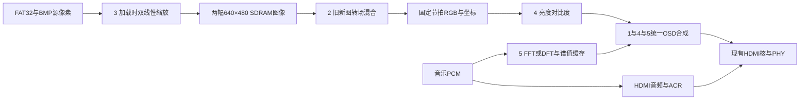

# 五项扩展要求及组合改动评估

本评估基于当前 `fpga_hdmi_top` 及配套 RTL，比较在基础功能之上增加五项扩展的改动范围、算法难度和集成关系。基础代码已完成编写及公开接口静态检查；以下增量分析以基础功能行为正确为前提，不将基础功能后续验证成本计入扩展难度。

评估默认保留 640×480 HDMI 输出、25 MHz 像素时钟、125 MHz 串行时钟及150 MHz SDRAM时钟。扩展3改变的是可接受的输入图片尺寸，不要求将HDMI输出改为1080P。本次只新增评估文档，没有修改RTL、生成IP或运行仿真、综合。

## 结论

改动最集中且复用关系最好的是 **1+4**。用户提出的 **1+2** 属于中高难度，需要实质改造帧缓存读取和换图控制。**3+4** 主要难点在3；**1+2+3+4** 属于两个关键图像子系统的改造，整体为高难度。**全部五项** 在架构上可以统一设计，但还需要独立的音频分析子系统和器件资源核算，属于很高难度。

五项可以按下列关系理解：

- 1、4、5共用像素坐标、OSD合成、字体或图形绘制、时序延迟对齐框架。
- 2改造SDRAM双图读取及帧区域占用管理，能复用Alpha运算设计，但不能直接使用现有单图读取流程完成淡入淡出。
- 3优先在图片加载阶段完成缩放，将输出统一成640×480，再写入原有帧缓存，可降低与2的耦合。
- 5的主要成本在音源、FFT/DFT、定点处理和音频跨域，图形叠加只是它的后半部分。

## 需求边界

按 `docs/赛题.pdf` 第14至16页分别评估：

| 项目 | 本评估计入的完整内容 | 不足以单独覆盖该要求的简化做法 |
|---|---|---|
| 1 | 多图层Alpha混合、动态文字、时间戳/标语、安路Logo | 只显示固定且完全不透明的一行字 |
| 2 | 双图Alpha渐变的淡入淡出，或满足连续显示的左右滑动切换 | 现有垂直消隐直接换帧本身 |
| 3 | 解析源宽高、双线性插值、缩放至640×480 | 只放宽BMP头检查、截取图片、仅做最近邻缩放 |
| 4 | 四个拨码开关，2位控制亮度、2位控制对比度，并通过OSD显示参数与状态 | 只改RGB数值而没有参数OSD |
| 5 | 24位PCM采集、FFT或自研DFT频谱能量计算、频谱柱或波形叠加 | 只做音量峰值柱，或只有波形绘制而没有题目要求的频谱计算 |

第2项以下以实现一种双图交叉淡入淡出为基准，不同时要求实现所有转场。第5项的保守完整实现包含音乐PCM来源，不能只用现有固定测试音演示就声称已经覆盖“随音乐律动”。最终验收口径应以赛题方说明为准。

## 当前可复用部分

| 现有部分 | 可复用程度 | 扩展限制 |
|---|---|---|
| 实际生成的两个PLL | 高 | 五项均可保持当前显示分辨率与时钟；外部音频时钟需另外处理 |
| HDMI协议核、PHY、SDRAM底层控制器 | 高 | 上层新增处理必须维持行连续输入及控制器访问规则 |
| FAT32根目录枚举、单文件读取、SPI | 对1至4较高 | TF卡音乐与图片同时读取时，现有单文件上下文不够 |
| 两个SDRAM帧区域 | 对2有帮助 | 当前只读取单幅前台图，没有双图配对读取；旧前台区域在提交后可被下一次加载重用 |
| BMP解析器 | 对1、2、4、5可复用 | 对3需要大改：宽高、像素数、图像长度均固定，且没有通用行填充处理 |
| 视频数据流模块 | 时序框架可复用 | 当前未对外提供逐像素坐标及通用处理流水接口 |
| 内部I2S与24位并行样本接口 | 可作为5的开发接入点 | 音源是固定测试音，接收器针对同像素时钟的内部信号；不能直接当成已完成的外部I2S输入 |

代码定位：`rtl/image/bmp24_decoder.v:30` 起固定源尺寸；`rtl/framebuffer/sdram_frame_store.v:54` 起固定目标帧几何，且仅维护单个读取地址；`rtl/video/video_stream_640x480.v` 维护坐标但未输出给OSD；`rtl/fpga_hdmi_top.v:265` 起连接内部测试音与HDMI音频。

## 单项改动

难度分为中、中高、高、很高。改动幅度描述代码影响范围，不是实际资源占用比例。相同难度等级下，组合项目仍会增加工作量。

| 项目 | 主要新增模块 | 主要修改位置 | 幅度 | 难度 |
|---|---|---|---|---|
| 1 | 字体/Logo ROM、文字与时间计数、图层发生器、Alpha合成与时序对齐 | 视频数据流、顶层 | 中，集中于显示输出 | 中 |
| 2 | 双图块缓存、转场系数与状态、双图配对读取/混合 | 帧缓存调度器、轮播控制、顶层 | 大，核心缓存控制变化 | 中高 |
| 3 | 通用BMP行解析、坐标步进、双行缓存、双线性插值器 | BMP解析器、加载握手、顶层；目标帧调度可大部分保留 | 大，输入处理重构 | 高 |
| 4 | 拨码同步、参数译码、RGB增益偏置和饱和、参数文字OSD | 顶层、视频数据流 | 小至中；包含独立OSD时为中 | 中；在1基础上追加较低 |
| 5 | 音乐PCM接入、采样缓存、FFT/DFT、窗/缩放与能量处理、谱值缓存、绘图 | 音频输入/分发、视频合成、顶层；TF音乐方案还涉及存储栈 | 大，新增音频分析子系统 | 高；TF卡同步音乐方案更高 |

### 扩展1

建议在原RGB流之后、HDMI协议核之前增加OSD。像素坐标与 `valid/user/last` 必须随RGB一同延迟，保证一行640个有效像素连续输入，行周期和帧周期不被新增处理改变。

字体和小尺寸Logo适合放在ROM，实时合成，无需把OSD写回SDRAM整帧。多层Alpha需要明确图层顺序、位宽、舍入和饱和，动态文字与时间信息应按帧更新，避免一次显示中出现前后不一致的数字。

上电运行时间可由现有时钟计数得到；若时间戳要求真实日期和时刻，当前设计缺少校时来源，需要另外定义RTC或校时接口。这不应被隐含计入一个普通计数器。

### 扩展2

现有后台图完整加载后，在下一次帧请求立即成为前台，提交结果会允许轮播控制器继续加载。淡入淡出需要在一段时间内同时保留旧图与新图，因此需要增加转场状态和区域锁定，转场结束前禁止下一次加载覆盖旧图。

两个区域仍然够用，前提是转场期间不预加载第三张图，按键请求继续排队。Alpha按帧步进并锁存，避免同一帧中途改变混合权重。

可选实现路线：

1. 在150 MHz存储域先读旧图块缓存，再读新图块并混合，合成结果进入原视频FIFO。可保留现有视频跨域FIFO接口，但需要改造读调度和增加块缓存。
2. 两幅图分别送入读FIFO，在25 MHz像素域配对混合。像素处理更直观，但增加FIFO、配对计数、两路预取与同步复位控制。

当前控制器适合4字对齐的连续访问，第一条路线可沿用64字事务。左右滑动还涉及变动列起点、拼接位置及非64字边界，不能预设比Alpha淡入淡出更省改动。

### 扩展3

当前解析器只接受640×480，不处理其他宽度的BMP行填充。应新增动态宽高、行跨度 `(3×width+3)&~3`、上下方向、越界尺寸及截断文件检查，并以四邻点完成双线性插值。

优先选择“读取图片时缩放到640×480，再写入后台帧”的路线。这样显示端和转场始终读取统一尺寸，原帧缓存容量、输出视频时序和HDMI IP可以保留。

采用源图双行缓存可避免把完整原图与两幅目标图同时放入SDRAM。源宽1920、RGB888、两行的原始数据为11520字节，实际RAM资源还取决于端口和器件映射。流式处理需处理下采样跳行、上采样重复使用源行、边缘夹取、宽或高为1的情况，并通过现有文件反压停住输入。

“任意分辨率”在有限硬件上仍需要明确输入尺寸上限、头字段溢出处理和超限策略；仅支持少数固定输入尺寸不能直接称为完整支持任意尺寸。长宽比保持、黑边或裁剪不是该页明确指定的算法要求，若另行选择会增加边界处理。

### 扩展4

顶层新增4位拨码输入并同步；2位亮度和2位对比度各形成4档参数。对RGB三个分量进行有符号增益/偏置运算、舍入及0至255饱和处理，参数按帧锁存。

有限档位可以选择便于移位与加法实现的系数，减少DSP需求。参数OSD可只使用较小字库。若已经实现1，4可复用坐标、字库、文字与合成模块，增量主要是拨码与RGB运算；1的Logo和动态标语仍是额外内容。

建议先调节背景图，再叠加参数文字，以免对比度极端设置让参数显示不可读。

### 扩展5

现有24位样本接口方便接入分析分支，但当前数据来自内部1 kHz测试音。频谱处理可以先在该音源上建立，完整音乐演示还要选择音乐来源，并让频谱与HDMI实际播放的PCM一致。

| 音源路线 | 现有设计上的额外成本 |
|---|---|
| 保留内部测试音 | 音源改动少，但只覆盖频谱算法演示，不足以直接承诺音乐律动要求 |
| 外部I2S音乐PCM | 增加真实输入接收、时钟域处理、采样缓存；外部独立采样时钟还需与播放节拍、ACR保持一致 |
| TF卡WAV PCM | 增加WAV解析及音频预取；当前FAT32一次只打开并顺序读完一个文件，需支持图片与音频访问调度、多上下文或其他明确的缓存方案 |

应当计算频谱能量，而非只测峰值。较小点数、定点、时分复用的FFT或DFT适合48 kHz输入速率；不能套用高吞吐全并行结构而忽略器件预算。256点和512点可作为后续方案比较起点，不代表本轮已确定参数。

频谱结果还需要幅值/能量压缩、平滑和柱高映射；谱值表按帧快照更新，柱状图可作为OSD图层生成，不必占用一幅完整SDRAM图层。若实现1或4，可复用其显示框架，但FFT/DFT和音源处理成本仍然存在。

## 本地FFT与器件预算核对

当前TD安装目录 `D:/TD/ip/depot/Catalog.xml` 中，`FFT_1.0` 所属条目的 `deviceRegexp` 仅列出 `DR1/PH1/PH2`，未列EG4。因此不能把它当成已确认能为本项目直接生成的FFT核。安装中另有旧版 `ip/fft/fft.tcl`，仅发现脚本不代表已经确认其EG4支持和资源规模；后续需要单独确认，或采用可移植FFT/自研DFT。

本机设备资源表 `D:/TD/arch/device_resource/device_resource.csv` 将EG4S20BG256列为19600 LUT、19600 DFF、29 DSP、4 PLL、1088 Kbit ERAM及64 Mbit SDRAM。它是总预算，不是当前项目的剩余量；本轮没有综合后的资源占用数字。

1、2的Alpha，3的插值，4的增益以及5的频谱都可能使用乘法资源。全五项组合应统一规划：显示链采用固定吞吐流水线，加载时缩放和48 kHz音频分析尽可能时分复用，有限档位的运算用合适的移位加法结构。共用算法模块或OSD框架不等于多个同时处理阶段可以零成本共用同一组乘法器。

## 容量和吞吐约束

以下为当前频率和32位像素存储格式的算术估计，不是实测带宽：

| 项目 | 数值 | 含义 |
|---|---:|---|
| 两幅640×480目标图 | 2457600字节 | 当前8 MiB SDRAM容量足够；2通常不必增加第三幅目标图 |
| 单幅1920×1080原图，32位/像素 | 8294400字节 | 几乎占满8 MiB，无法同时保留当前两幅目标图；支持3时不宜默认整幅原图缓存 |
| 当前单图平均读取载荷 | 约73.14 MB/s | 640×480×59.52381×4 |
| 淡入淡出两图平均读取载荷 | 约146.29 MB/s | 若每个目标像素各读旧图和新图一次 |
| 淡入淡出有效区瞬时载荷 | 200 MB/s | 25 MHz×2×4字节；需要FIFO缓冲事务间隙 |
| SDRAM接口理论峰值 | 600 MB/s | 150 MHz×4字节；不能按此直接保证实际稳定吞吐 |

显示双图的理论载荷没有直接超过SDRAM接口峰值，但实际仍要扣除事务排空、刷新、方向切换、混合运算和仲裁开销；同一控制器不支持读写同时运行。加载时缩放并把OSD留在显示末端，可以避免3、1、4、5各自增加整帧随机读开销。

当前SPI为5 MHz，仅按串行有效载荷计算：640×480 RGB888至少约1.47秒，1280×720约4.42秒，1920×1080约9.95秒；实际还要增加命令、FAT与协议间隙。因此3支持大图后，加载响应会明显变长。若另外要求大图快速加载或TF卡音频连续播放，SPI/FAT吞吐优化应单独计入。

## 全部31种非空组合

“显示”包括像素坐标、处理流水、OSD与时序对齐；“缓存”包括双图读取与转场占用控制；“输入”指图片解析和加载时缩放；“音频”包含PCM来源与频谱计算。组合共享框架但不是单项工作量简单相加。

| 组合 | 改动边界与幅度 | 总体难度 | 主要复用或新增难点 |
|---|---|---|---|
| 1 | 显示，中 | 中 | 多图层OSD、Alpha、动态信息 |
| 2 | 缓存及轮播，大 | 中高 | 双图读取和转场期间保护旧图 |
| 3 | 图片输入，大 | 高 | 通用BMP行处理、双线性插值 |
| 4 | 显示及拨码，小至中 | 中 | 独立实现时还需参数OSD |
| 5 | 音频及显示，大 | 高 | 音乐PCM、FFT/DFT、谱值绘制 |
| 1+2 | 显示及缓存，中至大 | 中高 | 共用Alpha设计；转场和OSD分层处理 |
| 1+3 | 图片输入及显示，大 | 高 | 缩放后统一目标尺寸，OSD相对独立 |
| 1+4 | 显示，中 | 中 | 字库、坐标、合成框架复用最直接 |
| 1+5 | 音频及显示，大 | 高 | 共用图层合成；频谱子系统独立新增 |
| 2+3 | 图片输入及缓存，大 | 高 | 输入缩放与双图调度各自改造 |
| 2+4 | 缓存及显示，大 | 中高 | 混合后调色，参数OSD不参与转场 |
| 2+5 | 缓存、音频及显示，大 | 高 | 双图调度与频谱运算共同核算资源 |
| 3+4 | 图片输入及显示，大 | 高 | 难点以3为主，4可独立追加 |
| 3+5 | 图片输入、音频及显示，很大 | 很高 | 两套算法、行RAM和音频运算资源竞争 |
| 4+5 | 音频及显示，大 | 高 | 参数与谱柱共用显示框架 |
| 1+2+3 | 图片输入、缓存及显示，大 | 高 | 缩放统一尺寸后再做双图混合与OSD |
| 1+2+4 | 显示及缓存，大 | 中高 | 1+4共享OSD，2仍需缓存改造 |
| 1+2+5 | 显示、缓存及音频，大 | 高 | 合成框架共享，Alpha与谱运算需统筹 |
| 1+3+4 | 图片输入及显示，大 | 高 | 1+4共享输出，3是主要算法难点 |
| 1+3+5 | 图片输入、音频及显示，很大 | 很高 | 显示可复用，插值和频谱成本仍同时存在 |
| 1+4+5 | 显示及音频，大 | 高 | 三项OSD复用强，音源与频谱主导难度 |
| 2+3+4 | 图片输入、缓存及显示，大 | 高 | 在2+3基础上追加参数运算与OSD |
| 2+3+5 | 图片输入、缓存、音频及显示，很大 | 很高 | 三条处理链与缓存、DSP资源共同规划 |
| 2+4+5 | 缓存、音频及显示，大 | 高 | 参数与谱图复用OSD，旧新图混合另管 |
| 3+4+5 | 图片输入、音频及显示，很大 | 很高 | 3与5主导，4可复用谱图显示框架 |
| 1+2+3+4 | 图片输入、缓存及显示，大 | 高 | 两处核心改造：加载缩放、双图转场 |
| 1+2+3+5 | 图片输入、缓存、音频及显示，很大 | 很高 | 显示复用不能消除3与5的算法工作 |
| 1+2+4+5 | 显示、缓存及音频，大 | 高 | 不改通用图片输入，但新增转场与频谱 |
| 1+3+4+5 | 图片输入、音频及显示，很大 | 很高 | 插值与频谱并存，OSD统一管理 |
| 2+3+4+5 | 图片输入、缓存、音频及显示，很大 | 很高 | 输入、双帧及音频三部分联动 |
| 1+2+3+4+5 | 全部主要处理链，很大 | 很高 | 统一架构、乘法与RAM预算、完整状态联动 |

所有含5的难度均需再按音源路线调整；如果选择同一TF卡实时音乐与图片并行访问，还要额外重构文件访问调度。这里的“高”不代表某个现成FFT IP已经确认可用于EG4。

## 组合实现时的统一结构

未选功能用等延迟旁路或对应有效接口处理，保持RGB与控制信号一致。OSD放在转场与背景调色之后，可让标语、Logo、参数和谱柱保持清晰；整个系统继续使用同一最终设计，不依赖切换不同固化镜像。

若确定未来目标包含1至4，建议在正式扩展前先定义通用像素接口和转场区域占用接口，再实现加载时缩放。若目标还包含5，应先确定音乐来源、EG4可用的频谱实现及定点资源预算，避免视频部分先占满DSP或RAM。

以当前结构选择组合时：优先考虑1+4以较小核心改动获得完整显示扩展；需要转场则选择1+2或1+2+4；明确需要任意输入尺寸时再进入3；全五项按统一架构推进，并在后续允许的阶段逐项确认资源和实际运行表现。
