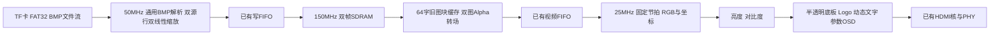

# 项目交接文档：基础RTL → 扩展1、2、3、4

更新时间：2026-10-24。本文供新对话中的接力模型阅读，记录用户要求、当前文件状态、已核对的IP/素材，以及下一阶段工作。文中的“已完成”仅限明确列出的代码编写或静态数据检查，不代表上板功能已验证。

## 1. 先读这部分

- **下一阶段目标：在现有基础RTL上完成扩展1、2、3、4，并整合为同一个最终设计。扩展代码目前尚未编写。**
- 基础RTL已经写好；四个新增RAM/ROM已由用户在TD手动生成，参数、公开端口及ROM初始化数据已核对通过，不必重新规划或要求用户重复生成。
- 字模、Logo及MIF已准备好，直接使用`assets/osd`现有资源。
- **当前`project1.al`的顶层和源码登记不完整，后续集成时必须修正，见第3节。**
- 本轮交接只整理文档，没有修改RTL、IP、工程文件或素材。

### 用户已经明确的工作边界

1. 本阶段进行RTL代码编写及必要的工程源文件登记；**不运行任何仿真、综合、布局布线、烧录或上板验证**。普通文本/参数/端口核对和素材字节一致性检查不等于这些实现流程。
2. 保留全部基础功能：TF卡BMP读取、SDRAM缓存、按键/自动轮播、I2S测试音与HDMI音视频输出。
3. 按键映射固定：**按键1上一张、按键2下一张、按键3开关自动轮播、按键4复位**。现有`key_n[0..3]`低有效。
4. 用户接受实际HDMI PLL输出**125MHz / 25MHz**。不要再次要求改成126MHz / 25.2MHz，也不要悄悄按请求频率计算时序或ACR。
5. SDRAM接口移相时钟为**150MHz、180°**。
6. 用户规定IP变更流程：AI提出参数 → 用户在TD人工配置生成 → AI读取实际文件核对后连接。不要手写或修改生成文件来冒充重新生成IP。
7. 用户已确定时间戳为**上电运行时间`HH:MM:SS`**，标语为**`安路 FPGA 多媒体展示`**。不用增加RTC或校时需求。
8. 本次只做扩展1至4，不加入扩展5、FFT/DFT、音乐频谱、WAV播放或其他未要求功能。

后文会区分“赛题要求”“已有代码”和“规划默认值”。资料中的示例、界面默认值不是新增的用户指令；以用户要求和实际生成文件为准。

## 2. 工作目录、Git与阅读入口

当前完整成果位于这个Codex工作树：

```text
C:\Users\30909\.codex\worktrees\ef86\fpga_hdmi_project
```

原始工程位置是`D:\fpga_hdmi_project`，但最新素材和新增IP在上述工作树中。新对话可复用当前工作树，或从`extension-1-4-prep`分支的交接准备提交继续；不能只检出旧的基础提交。

- Git基准提交：`1393d38`，提交说明`基础要求初版`。
- 仓库用户：`eren <3090936197@qq.com>`，仅配置在本仓库。
- 本次已建立分支`extension-1-4-prep`保存交接准备快照，提交说明为`准备扩展1至4的IP、OSD素材与项目交接`。具体提交号通过`git log -1`读取；新增IP、素材和交接文档随该提交保存。
- 新对话先查看`git status`，保留提交后可能新增的修改，不要回退到只有基础版的`1393d38`。
- `.gitignore`已忽略`tmp/`、`log/`、`.lock.f`及TD会话文件。
- `.gitattributes`对`assets/osd`关闭自动换行转换，按原始字节保存素材，保持资源清单中的SHA-256可复现。

建议阅读顺序：本文 → [基础RTL设计说明](RTL设计说明.md) → [素材说明](../assets/osd/README.md) → 关键RTL与实际IP包装。

| 入口 | 内容 |
|---|---|
| [赛题.pdf](赛题.pdf) | 文件第12、13页基础要求；第14页扩展1/2；第15页扩展3/4。使用当前更新版 |
| [显示器参数.docx](显示器参数.docx) | 使用的显示器资料；本方案保持640×480输出 |
| [SDRAM参考手册](APUG011_基于ERAM接口实现的高性能SDRAM读写v1.2.pdf) | 厂商SDRAM封装的使用限制、刷新及事务规则 |
| [HDMI参考手册](APUG092_HDMI1.4b_Transmitter_V1.0.docx) | HDMI协议核接口与时序要求 |
| [FIFO参考手册](IPUG012_Soft_FIFO用户手册_v3.0.pdf) | Soft FIFO规则；文件内版本为3.1 |
| `docs/pll`、`docs/soft_fifo`、`docs/RAM`、`docs/ROM` | 人工配置界面截图；实际生成结果优先于截图默认值 |
| `docs/reference_rtl/fat32`、`docs/reference_rtl/audio` | 用户提供的参考实现；不重复加入工程编译 |
| [fpga_hdmi_top.v](../rtl/fpga_hdmi_top.v) | 基础系统顶层 |
| [sources.f](../rtl/sources.f) | 基础版源清单和SDRAM include目录；尚未加入四个新IP |

## 3. 当前最重要的工程问题：尚未修复

实际读取[project1.al](../project1.al)发现：

- `<TOP_MODULE>`仍为`hdmi_tx_640x480`，而系统顶层文件`rtl/fpga_hdmi_top.v`已存在。
- Verilog登记仅9个厂商HDMI/SDRAM相关文件，缺少18个基础系统RTL文件，包括系统顶层、storage、image、framebuffer、video、control、common、audio等。
- 旧的2个PLL、FIFO以及4个新IP都已有IP入口登记；四个新`.ipc`各登记一次。
- `rtl/sources.f`当前有30个源文件路径，覆盖基础版26个RTL源及4个旧IP实现文件；`global_def.v`作为include头文件另行使用。**清单还没有四个新增RAM/ROM的`.v`文件。**

因此，后续实现时需要：将系统顶层设为`fpga_hdmi_top`，补齐基础及扩展RTL登记，并同步更新`sources.f`。TD工程使用`.ipc/.xml`入口引入IP时，不再重复登记同一模块的生成`.v`和`.vhd`；命令行源清单则按实际需要列出生成Verilog。

这是文件登记工作，不要求运行综合或其他TD实现流程。本轮保留工程现状，未擅自修改。

TD原生`.al`中含`UsedInP&R`这样的未转义文本，直接用标准XML解析器可能失败。可在内存中转义后读取，不要把它误判为IP错误或顺手重写整个工程格式。

## 4. 器件、时钟与复位

开发板HX4S20C，器件`EG4S20BG256`，TD版本`6.2.168116`。片内SDRAM为2M×32bit，即8MiB。器件总资源资料列有19600 LUT、19600 DFF、29 DSP、4 PLL及1088Kbit ERAM；这些是总量，**没有综合后的剩余资源或时序收敛结果**。

| 时钟 | 实际值 | 用途 |
|---|---|---|
| `clk_50m` | 50MHz | SD/SPI、FAT32、BMP与后续加载缩放、按键、轮播控制 |
| `pll_sdram.clk0_out` | 150MHz、0° | SDRAM控制器、帧缓存调度、后续转场混合 |
| `pll_sdram.clk1_out` | 150MHz、180° | SDRAM接口移相时钟 |
| `pll_hdmi.clk0_out` | 125MHz、0° | HDMI串行PHY |
| `pll_hdmi.clk1_out` | 25MHz、0° | 像素流、后续调色/OSD、内部音频与ACR |

HDMI固定有效区640×480、总时序800×525，实际刷新率约59.52381Hz。现有DDC参数`IIC_SCL_DIV=126`，约99.206kHz。

基础顶层用初始化为0的16位计数器产生65535个50MHz周期的上电复位；KEY4直接请求全局复位。两个PLL锁定后，各域经`reset_sync`同步释放。多位跨域命令使用`cdc_mailbox`，独立状态使用`cdc_level`。后续时间戳、图像状态和参数快照也应使用一致的跨域握手，不能逐位同步后假定数值原子一致。

## 5. 已有基础RTL及必须保留的行为

`rtl`共有27个`.v`文件，其中含SDRAM头文件。重点位置如下：

| 位置 | 已有职责 | 扩展时的主要改动 |
|---|---|---|
| `rtl/fpga_hdmi_top.v` | 三个时钟域、IP、存储/显示/音频连接 | 接入缩放、转场、拨码与OSD |
| `rtl/storage/` | SPI、SDHC/SDXC、512字节扇区、FAT32枚举与文件流 | 原则上复用，保留文件流反压 |
| `rtl/image/bmp24_decoder.v` | 只接受640×480的24位BI_RGB | 改造通用尺寸、行填充和缩放接入 |
| `rtl/framebuffer/sdram_frame_store.v` | 两个帧区域、单图读出、加载/提交/取消、手动刷新 | 改造双图配对读取与转场期间的区域保护 |
| `rtl/control/slideshow_control.v` | 上一张/下一张、自动轮播、异常跳图和待处理方向 | 提交应延后到转场完成，之后开始停留计时 |
| `rtl/video/video_stream_640x480.v` | 固定输出节拍及FIFO读取；内部已有x/y | 输出并对齐坐标，接入显示流水线 |
| `rtl/common/` | 复位、单比特/独立状态同步、多位握手 | 继续复用 |
| `rtl/audio/` | I2S测试音、接收、ACR | 保留基础音频，无需做扩展5 |
| `rtl/sdram/`、`rtl/hdmi_transmitter/` | 厂商控制器/协议核及PHY封装 | 保留厂商加密实现，按手册连接上下游 |

### 文件和控制行为

- SPI初始化250kHz，正常读取5MHz，Mode 0。
- FAT32支持512字节扇区、裸FAT32卷或MBR的0B/0C分区；文件和根目录可沿FAT簇链碎片化存放。
- 根目录枚举普通`.BMP`短目录项，顺序是目录中的存储顺序，不按名字排序；16位图片计数/索引，上限65535。
- 当前BMP只支持640×480、24位、BI_RGB，正480高度为底向上，负480为顶向下；输出32位`0x00RRGGBB`。
- 默认自动轮播开启，停留5秒；加载期间保存最近一次按键方向，首尾循环。解析失败跳过候选图并保留当前有效帧。
- 原参考RTL中有两处语法笔误，已在`rtl/storage`项目副本修复：`sd_spi_cmd`不完整的加一常量、`sd_spi_card`的CMD58条件缺右括号。不要用原始参考文件覆盖项目适配版。

### 帧缓存与SDRAM规则

两区域起始字地址分别为0和307200（0x4B000），每幅307200个32位字，双帧合计2457600字节。区域不是物理SDRAM的BA引脚分组。

- 当前只读一个前台图；新图完整写入后台，通过文件和写入检查后，在垂直消隐切换。**已有双缓冲不等于已实现双图淡入淡出。**
- 底向上BMP当前由SDRAM反向选择目标行地址来恢复上下方向；缩放改造时防止重复翻转。
- 事务为64个连续32位字，起始地址/长度满足4字对齐；读写互斥，方向切换前排空请求和返回流水。
- 用`Sdr_rd_en`接收读返回，不能假定请求当拍得到数据。
- 手动刷新：`SELF_REFRESH_OPEN=0`，每4000个150MHz周期安排刷新，经`App_ref_req`请求并等待`Sdr_init_ref_vld`完成。
- 手册将`Sdr_busy`标为保留，当前仲裁不依赖它。重构时仍要保证事务与刷新互斥，不能因为转场或背压饿死刷新。
- 每帧垂直消隐协调复位视频FIFO两端，保持96个SDRAM周期，再等复位完成、预取至少640像素。后续转场状态不能被这一帧同步流程错误清掉。
- HDMI有效行不能暂停；RGB、坐标、`valid/user/last`必须经过相同流水延迟。

### 基础音频

25MHz域产生约1kHz双声道测试音，24位有效样本、32位声道时隙、64fs I2S。分数累加器产生平均3.072MHz BCLK和48kHz样本率；BCLK是内部信号，寄存器仍由25MHz驱动。接收后的左右样本送HDMI，ACR为`N=6144`、`CTS=25000`，每48对样本更新一次。不要误改成按25.2MHz计算。

## 6. 已有PLL与FIFO

两个PLL实际输出见第4节，无需新增PLL。FIFO定义是`al_ip/fifo_pixel_async/fifo_pixel_async.v`，基础顶层已分别例化加载FIFO和视频FIFO：

| 项目 | 实际参数 |
|---|---|
| 时钟 | 异步；加载50→150MHz，显示150→25MHz |
| 宽度/配置深度 | 32位×1024；当前普通模式可用容量1023字 |
| 模式 | `SHOW_AHEAD_EN=0`，`OUTREG_EN="NOREG"` |
| 存储 | `MEMORY_TYPE=4`，ERAM9K timing |
| 复位 | `RST_TYPE=1`，两侧异步高有效复位；2级同步 |
| 水位/计数 | 将满896、将空256；`wrusedw/rdusedw`均10位 |
| 完成信号 | `wr_rst_done`、`rd_rst_done`；两侧完成后才能操作 |

读端使用`re`及`valid`返回，不把它当Show Ahead FIFO。需要预留整块输出空间，并保留溢出、欠读和跨域复位处理。后续采用存储域预混合，仍只跨出一条像素流，因此现阶段不需要新的FIFO定义。

## 7. 四个新增IP：已人工生成并静态核对通过

文件采用`al_ip/<模块名>.v/.vhd/.ipc`平铺存放。实际四个`.ipc`均选择Verilog启用、VHDL禁用，目标器件EG4S20BG256；不要同时编译同名的Verilog和VHDL包装。

| 模块 | A/B位宽、深度 | 地址 | 实际模式/介质 | 后续实例数、时钟 |
|---|---|---|---|---|
| [ram_scale_line](../al_ip/ram_scale_line.v) | 均24位×4096 | A/B均12位 | `PDPW`，`9K(FAST)` | 2个，A/B都接50MHz |
| [ram_fade_block](../al_ip/ram_fade_block.v) | 均32位×128 | A/B均7位 | `PDPW`，`9K(FAST)` | 1个，A/B都接150MHz |
| [rom_osd_font](../al_ip/rom_osd_font.v) | 8位×8192 | 13位 | `SP`，`32K` | 1个，25MHz |
| [rom_anlogic_logo](../al_ip/rom_anlogic_logo.v) | 16位×8192 | 13位 | `SP`，`32K` | 1个，25MHz |

### RAM实际公开端口

| 端口 | 方向/用途 | 行RAM | 转场RAM |
|---|---|---|---|
| `dia` | 输入，写数据 | 24位 | 32位 |
| `addra` | 输入，写地址 | 12位 | 7位 |
| `clka` | 输入，写时钟 | 50MHz | 150MHz |
| `wea` | 输入，高有效写使能 | 1位 | 1位 |
| `addrb` | 输入，读地址 | 12位 | 7位 |
| `clkb` | 输入，读时钟 | 50MHz | 150MHz |
| `dob` | 输出，读数据 | 24位 | 32位 |

RAM均`REGMODE_A/B="NOREG"`、`WRITEMODE_A/B="NORMAL"`；A写B读，B写使能固定0，内部`cea/ceb=1`、`ocea/oceb=0`、`rsta/rstb=0`；`INIT_FILE/FILL_ALL="NONE"`。`.ipc`的`enable_a/b=disable`是取消外部CE控制，**不是关闭读写端口**。

### ROM实际公开端口与初始化

两个ROM都只有输入`addra[12:0]`、输入`clka`、输出`doa`；字库`doa[7:0]`，Logo`doa[15:0]`。写入被固定禁用，内部A口使能为1，B口关闭，复位固定0，`REGMODE_A="NOREG"`。

**这四个IP都没有外部复位、`re`、`valid`或`ready`端口。**按同步读使用，读地址/像素元数据需对齐；NOREG只是没有额外输出寄存器，不是组合读。读请求有效标志由用户RTL维护，不能套用FIFO的`valid`接口。复位时清控制状态和有效标记，不要求清整个存储阵列。

ROM实际`INIT_FILE`引用如下，以`al_ip`文件所在目录为基准能解析到现有文件：

```text
../assets/osd/td_init/osd_font_8x8192.mif
../assets/osd/td_init/anlogic_logo_argb4444.mif
```

对应`.mif.dath`是TD实际生成的HEX数据，位于同一`td_init`目录。迁移时保留`al_ip`与`assets`相对层级，不要只拷贝包装`.v`。

上轮静态核对逐一检查了`.v/.vhd/.ipc`的参数、端口及Verilog启用状态；两个ROM各8192字的MIF、TD生成DATH、原HEX和BIN逐字比较，**差异均为0**，Logo与量化PNG也一致。未运行厂商核仿真或实现工具；这不是对器件时序和运行行为的验证。

## 8. 素材：已生成，直接使用

入口：[assets/osd/README.md](../assets/osd/README.md)。不要为继续编写RTL重新生成图像或更换字体。若将来改变字模或初始化数据，必须保持字符表、MIF和TD生成数据同步，按用户规定流程重新处理ROM。

| 文件 | 用途 |
|---|---|
| `assets/osd/osd_font_8x8192.bin/.hex` | 完整8位字库 |
| `assets/osd/font_ascii_8x16.bin/.hex/.png` | ASCII字模及原尺寸图集 |
| `assets/osd/font_cn_16x16.bin/.hex/.png` | 中文字模及原尺寸图集，容量128字 |
| `assets/osd/font_cn_chars.txt`、`font_map.json`、`font_cn_map.csv` | 固定中文字序、索引及地址 |
| `assets/osd/osd_text.txt`、`osd_strings.json` | 确定的显示文案 |
| `assets/osd/anlogic_logo_128x64.png` | 量化后、带透明度、与ROM数据一致的Logo |
| `assets/osd/anlogic_logo_argb4444.bin/.hex` | Logo像素数据；BIN为小端16位字 |
| `assets/osd/td_init/*.mif`及`*.mif.dath` | ROM初始化源及TD生成数据 |
| `assets/osd/preview/` | 字模、透明度及640×480静态排版预览；不是上板结果 |
| `assets/osd/source/` | 用户原Logo副本、透明底派生图及处理记录 |
| `tools/build_osd_assets.py` | 可重建素材/MIF，使用Pillow和本机Windows字体；本阶段无需重跑 |

### 字库寻址

1bit掩码，1为前景，0为透明；逐行、先上后下；每字节最高位对应最左像素。

```text
ASCII：8×16，每行1字节；address = code*16 + row
中文：16×16，每行2字节；address = 2048 + index*32 + row*2 + half
half=0为左8像素，half=1为右8像素

0000..07FF：128个ASCII码位，共2048字节
0800..17FF：128个中文槽，共4096字节，前28槽有效
1800..1FFF：预留，共2048字节，全0
```

ASCII0至31、空格32及127为空白，其余94个可打印字符有字形。中文字序从0开始，固定为：

```text
安路多媒体展示运行亮度对比轮播开状态显图片关加载转场错误
```

按`font_map.json`映射中文索引，不可把Unicode或UTF-8字节直接当ROM地址。仅需编码已有文案，不要求在硬件实现完整Unicode文本解析。

### Logo寻址

128×64=8192个像素，地址`y*128+x`，左上到右下。16位ARGB4444：`[15:12]A [11:8]R [7:4]G [3:0]B`，A=0透明，A=15全不透明。RGB/Alpha从4位还原8位时乘17；若合成器权重用0..256，应明确将全不透明映射到256。画布含上下透明留白，保持比例。

已比对的二进制SHA-256：

```text
osd_font_8x8192.bin
52a4256b77bd2ed429312686c7d4d7d99579e5af58e70c4c4d8335b00f8bc93a

anlogic_logo_argb4444.bin
82a6d154c39112da014b81ed3a5fadc18006a8a9b68fd73a100364c2f857f7b1
```

## 9. 扩展1至4的统一实现方案

以下是前期已经采用、并据此人工生成IP的架构。具体RTL状态机和流水线还未实现。



### 扩展3：加载时双线性缩放

赛题要求解析原始宽高，以双线性插值缩放至HDMI输出尺寸；不能用最近邻或简单截取代替。

当前规划默认：源宽高各1..4096，输出始终640×480，仍只接受24位BI_RGB BMP，整图拉伸填满，不额外加黑边/裁剪功能。**4096是有限资源下的设计上限，不是赛题明文指定，也不能宣称无上限支持任意尺寸。**行RAM的实际深度已经是4096；超限应拒绝并保留当前图。

- 两个`ram_scale_line`轮换存相邻源行，分时读取四邻点并插值。通过文件流`file_ready`反压保护仍需使用的行；下采样跳过无关源行，上采样重复利用已缓存行。
- 解析动态宽高、正负高度及BMP行跨度`(3*width+3)&~3`，消费行尾填充。检查头字段、偏移、文件长度、截断和算术溢出。
- 尺寸4096本身需要13位表示，行地址4095只需12位；不要把尺寸计数直接截成RAM地址宽度。
- 边界夹取，宽/高为1也能处理；可用固定输出尺寸的整数商/余数累加产生源坐标，避免为此新增除法IP。
- 乘加可在加载域分时复用，避免不必要的全并行DSP使用。
- 输入文件结束不等于目标像素已输出完；`done/image_complete/finish`必须在307200个目标像素按握手送完后才能成立。兼顾取消、错误以及FIFO尾部排空。
- 底向上BMP与现有SDRAM反向行写配合处理，防止上下翻转两次；不缓存整幅4096原图到SDRAM。

### 扩展2：双图交叉淡入淡出

赛题允许淡入淡出或左右滑动，已选择前者，不需要再实现滑动或准备动画文件。

- 新图完整加载成功，在帧边界开始转场；第一幅有效图直接显示。
- 150MHz域先读旧图64字块至`ram_fade_block`，再读新图对应块，逐像素混合到现有视频FIFO。128字RAM按两个64字块组织。
- 权重9位，范围0..256；建议每帧加4，共64个帧间隔，约1.075秒。整帧锁存系数。

```text
out = ((256-alpha)*old + alpha*new + 128) >> 8
```

- 转场期间锁定两区域，不能让下一次加载覆盖旧图；不预加载第三张图。保留最近一次手动方向请求，自动停留5秒从转场完成后计时。
- 重构当前`finish/result`提交语义：不要在转场刚开始时就允许轮播控制器重用旧区域。保护所有在途SDRAM读返回、块RAM读延迟和混合流水。
- 限定完整块的FIFO可用空间，保留刷新和帧同步。出错时不提交半成品，保持现有有效图。

### 扩展1：多层Alpha及动态文字

在调色后叠加背景面板、Logo、文字。上电运行时间每秒变化，标语横向滚动；所有动态参数/位置按帧更新，防止一帧内变化。

默认布局可沿用素材预览：左上运行时间，右上128×64 Logo，左下参数与状态，底部16像素高滚动标语。各文字区域不重叠，共用一个单端口字库ROM；Logo独立ROM。多层Alpha不是仅以不透明字形替换背景，至少保留面板半透明和Logo透明度合成。

同步延迟RGB、x/y、字形位选择、Logo Alpha及HDMI`valid/user/last`；保持每个有效像素一拍，不能因ROM访问或算术暂停有效行。透明字形位应显示下层内容，不能画成黑色实底。

### 扩展4：四拨码亮度/对比度及参数OSD

赛题明确开关1、2用于亮度，开关3、4用于对比度，各四档，系数由FPGA组合逻辑实时计算，并显示参数数值及状态。

前期规划默认值如下，属于实现选择，不是赛题强制数值：

| 两位编码 | 亮度偏置B | 对比度C |
|---|---:|---:|
| 00 | -32 | 0.5 |
| 01 | 0 | 1.0 |
| 10 | +32 | 1.5 |
| 11 | +64 | 2.0 |

亮度编码以开关2为高位、1为低位；对比度以4为高位、3为低位。公式：

```text
B = 32 * (brightness_code - 1)
C = (contrast_code + 1) / 2
channel_out = clamp(round((channel_in-128)*C) + 128 + B, 0, 255)
```

使用有符号扩位，尤其防止编码00减1下溢。上述系数可用移位/加法。两组都为01时为原图参数。拨码先同步和稳定检测，组合译码，按帧锁存；图像调色在OSD之前，保证文字可读。

当前顶层尚无拨码输入，板级引脚/ON电平/电压映射也尚未提供。后续可以先定义4位逻辑输入并完成RTL，不编造物理引脚约束，不因缺少引脚资料暂停其他代码工作。

## 10. 容量与吞吐只作规划依据

- 双目标帧2457600字节，仍使用两个帧区域。
- 新增RAM/ROM的逻辑容量合计397312bit，即388Kibit；不是实际物理块占用。两个行RAM实例都要计入。
- 淡入淡出双图平均读取载荷约146.29MB/s，有效区瞬时200MB/s；SDRAM接口理论峰值600MB/s。实际仍受刷新、事务排空和流水延迟影响，不能按理论峰值承诺稳定吞吐。
- 5MHz SPI纯有效载荷下，640×480 RGB888至少约1.47秒，1080P至少约9.95秒；大图加载时持续显示当前帧，不承诺立即响应或另行提高SPI频率。

## 11. 接力后的工作顺序和交付检查

用户在新对话要求继续编写时，建议按以下顺序完成，而不是重新停留在IP和素材规划：

1. 阅读关键模块和已生成IP，确认交接准备提交及当前工作树状态；梳理加载、帧请求、转场提交及像素流水接口。
2. 编写通用BMP解析和加载时双线性缩放，接入两个实际行RAM，输出仍为640×480目标像素。
3. 重构SDRAM读调度和轮播控制，接入转场块RAM，实现双图渐变、区域保护和完成握手。
4. 暴露像素坐标，增加拨码、亮度/对比度、多层OSD、运行时间和滚动标语。
5. 接入现有音视频顶层，补齐`project1.al`与`sources.f`，系统顶层选`fpga_hdmi_top`；不要动厂商加密内核或改造IP生成文件。
6. 在用户范围内做静态语法、文件、参数与连接检查；明确说明未做仿真、综合、布局布线和硬件验证。按最终实现更新本文及基础说明中的状态，不能仅凭代码已写完宣称上板成功。

当前基本版曾进行Verilog-2005语法及公开接口静态检查并报告0错误；这是历史基础版本的记录，不是扩展设计验证。旧静态工具/脚本可能仅在原`D:`目录的忽略`tmp`下，当前工作树`tmp`只有PDF中间文件，不要假定工具已随Git迁移。不要解密或替换厂商实现来冒充验证其功能。

已有数据核对结论可复用，不必重复要求用户准备Logo、字体、MIF或同规格IP。若实际实现确需改变IP参数，先完成具体方案，再按用户的人工生成流程处理。

## 12. 文档清理与新对话提示词

此次保留了`docs/RTL设计说明.md`并修正其中已失效的工程登记描述。旧的五项组合评估、扩展资源准备、手动ROM/RAM配置清单已被本文中的选定方案、当前资源和实际接口记录替代，删除对应3份MD。厂商手册、赛题、显示器资料、截图、参考RTL和素材目录说明均保留。

可以把以下文字作为新对话的起始请求：

```text
请在 C:\Users\30909\.codex\worktrees\ef86\fpga_hdmi_project 继续本项目。
先完整阅读 docs/项目交接文档.md、docs/RTL设计说明.md 和 assets/osd/README.md，
再读取实际RTL及IP生成文件。在保留全部基础功能的前提下完成扩展1、2、3、4的RTL集成。
四个新增RAM/ROM和字模、Logo、MIF已经准备并静态核对通过，按实际接口使用。
按键1上一张、2下一张、3自动轮播开关、4复位；时间为上电运行时间，标语为“安路 FPGA 多媒体展示”。
沿用25/125MHz HDMI时钟、150MHz及180° SDRAM时钟；不实现扩展5。
需要补齐project1.al源码登记并将系统顶层设为fpga_hdmi_top，同时更新sources.f。
本对话只做RTL和必要工程文件编辑及静态核对，不运行任何仿真、综合、布局布线或烧录。
从extension-1-4-prep分支的准备提交继续，保留工作树已有修改，不要退回旧的基础提交。
若确需新增或修改IP，先列参数由我在TD手动生成。
```
